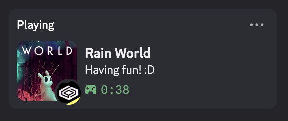

# notproton-discord-rpc-plugin

A plugin for [NotProton](https://github.com/NotProtonNot/NotProton) (v1.2+) that bridges Discord game presence from Wine to the macOS Discord desktop client.



## Overview

```text
Wine Prefix (Windows)
  Game Process
      │
      │ (\\.\pipe\discord-ipc-0..9)
      ▼
  notproton-discord.exe
      │
      │ Loopback TCP (127.0.0.1)
      ▼
macOS Host
  discord_bridge.dylib
      │
      │ UNIX Domain Socket ($TMPDIR/discord-ipc-0)
      ▼
  Discord Mac Client
```

Windows games communicate with Discord over Win32 named pipes (`\\.\pipe\discord-ipc-0` through `9`), whereas Discord on macOS listens on a UNIX domain socket. Wine does not bridge these sockets by default.

This plugin handles game presence through two paths:

- **Named Pipe Forwarding**: Injected via `DYLD_INSERT_LIBRARIES`, `discord_bridge.dylib` spawns `notproton-discord.exe` inside the prefix to bind `\\.\pipe\discord-ipc-0`..`9` and relay packets over authenticated loopback TCP to Discord's macOS UNIX socket. Games with built-in Discord SDK support use this path.
- **Steam AppID Fallback**: If no named pipe traffic occurs within 3 seconds, the dylib reads `STEAM_COMPAT_APP_ID` and `appmanifest_<appid>.acf`, then broadcasts a Rich Presence frame (`status_display_type: 2`, Client ID `1508914471433928824`) with the game title, elapsed timer, and Steam 600x900 cover art. If the game later opens a named pipe, fallback clears automatically.

> **Why fallback is an IPC broadcast, not native game detection:**  
> Discord's macOS scanner (`DiscordGameUtils`) polls `proc_pidinfo` and `NSWorkspace` to match running binaries against its database. NotProton's launcher sets `<key>LSUIElement</key><true/>` and names the process `wine` to keep helper windows out of the Dock—and Discord ignores `LSUIElement` background agents. Because `wine` isn't a recognized game binary, fallback presence pushes an RPC activity frame over Discord's IPC socket rather than triggering local process detection.

> [!IMPORTANT]
> Thus, note that discord will not understand the activity as a known game when using fallback as it is simply just a decorated rich presence from a Discord Application. This is a known problem and impractical to fix when LSUIELEMENT = true. 

## Requirements

- macOS 14.0+
- NotProton v1.2.0+
- CrossOver 26.3+ (paid version only)
- Rosetta 2 (FEX i.e CrosOver preview not supported under main branch but planned to add support after plugin-partt3 of Notproton is merged)
- Discord for Mac
- Basically everything NotProton requires
- `clang` and `mingw-w64` (only required when building from source)

## Installation

### From Source (Quick Install)

Clone to your home directory and run the installer:

```bash
cd ~ && git clone https://github.com/DevTheCoder-py/notproton-discord-rpc-plugin.git && cd notproton-discord-rpc-plugin && ./install.sh
```

All plugin files are copied directly into `~/Library/Application Support/notproton/plugins/`. Once the installer finishes, it will offer to delete the cloned build folder for you (or you can safely delete it manually).

### Pre-built Binaries

1. Download `notproton-discord-rpc-plugin.zip` from Releases.
2. Extract the archive and copy the files to your NotProton plugins directory:

```text
~/Library/Application Support/notproton/plugins/
  ├── discord-rpc.conf
  └── discord-rpc/
      ├── config.conf
      ├── discord_bridge.dylib
      └── notproton-discord.exe
```

If macOS Gatekeeper flags pre-built binaries downloaded via browser, remove the quarantine attribute (no sudo required):

```bash
xattr -dr com.apple.quarantine ~/Library/Application\ Support/notproton/plugins/discord-rpc/
```

## Configuration

1. In NotProton, verify that `Discord Rich Presence` appears under **Plugins**.
2. In Steam, open game **Properties** $\rightarrow$ **Compatibility** / **General**.
3. Under **Developer**, enable **Discord Rich Presence** (and pick **Presence mode** / **Cover art style** directly in the UI).

Global defaults live in `~/Library/Application Support/notproton/plugins/discord-rpc/config.conf` (`key = value`, applied on next game launch, preserved on updates). Steam UI options and **Launch Options** override `config.conf` per game:

| `config.conf` Key | Launch Option Override | Default | Description |
|---|---|---|---|
| `mode` | `DISCORD_RPC_MODE=...` | `auto` | `auto` (wait 3s then fallback), `fallback` (Steam presence only), or `native_only` (SDK pipes only). |
| `artwork` | `DISCORD_RPC_ARTWORK=...` | `cover` | `cover` (600x900), `header`, `hero`, `logo`, or `icon`. |
| `subtitle` | `DISCORD_RPC_SUBTITLE="..."` | `Steam via NotProton` | Subtitle under game name (empty `subtitle =` hides it). |
| `socket_dir` | `DISCORD_RPC_SOCKET_DIR` | Auto-detected | Custom directory for `discord-ipc-0`. |
| `client_id` | `DISCORD_RPC_CLIENT_ID` | `1508914471433928824` | Custom Discord Application ID for fallback presence. |
| `small_image` | `DISCORD_RPC_SMALL_IMAGE` | Empty (disabled) | Optional small badge image (URL or Discord asset key). |
| — | `DISCORD_RPC_DISABLE=1` | `0` | Disable the plugin for a single game launch. |
| — | `DISCORD_RPC_GAME_NAME="..."` | Auto-detected | Override game title (mods/shortcuts). |
| — | `DISCORD_RPC_STEAM_APPID=N` | Auto-detected | Override Steam AppID for title/art lookup. |

Launch option examples (`Properties` $\rightarrow$ `General` $\rightarrow$ `Launch Options`):
```bash
DISCORD_RPC_MODE=fallback DISCORD_RPC_SUBTITLE="Singleplayer" %command%
DISCORD_RPC_GAME_NAME="Skyrim Together" DISCORD_RPC_STEAM_APPID=489830 %command%
DISCORD_RPC_DISABLE=1 %command%
```

## Uninstallation

```bash
rm -rf ~/Library/Application\ Support/notproton/plugins/discord-rpc*
```

---

## Contributing

I don't really care and this probably won't break anytime soon. But if something actually breaks or Discord/Wine changes down the line, feel free to open a PR and I'll look at it. Though, please test with newer CrossOver versions if you can and report it!

---

## Acknowledgements

- Based on initial named-pipe bridge research and prototypes by [sn0wst0rm](https://github.com/sn0wst0rm) ([`sn0wst0rm/NotProton` (feat/discord-rich-presence)](https://github.com/sn0wst0rm/NotProton/tree/feat/discord-rich-presence)).
- Built for the [NotProton](https://github.com/NotProtonNot/NotProton) ecosystem.

---

## Disclaimer

Code implementation and debugging were AI-assisted(Especially ones written in C), while all project documentation, specifications, and architecture design were thoroughly reviewed and maintained by me. 
This project has only been verified to work on my own machines so far, an M1 mac mini and an M4 macbook air. Please create an issue if something goes wrong on your end.
